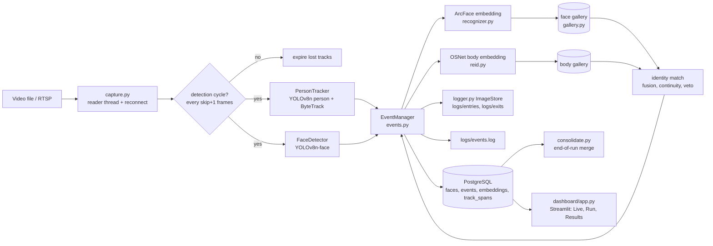

# Architecture

## Modules (`src/`)
| File | Role |
|---|---|
| `capture.py` | file or RTSP source; RTSP uses a reader thread that keeps only the latest frame and reconnects |
| `detector.py` | `FaceDetector` (YOLOv8-face) and `PersonTracker` (YOLOv8 person + ByteTrack) |
| `recognizer.py` | InsightFace ArcFace embeddings |
| `reid.py` | OSNet-AIN body embeddings (feature-centred) |
| `gallery.py` | multi-embedding gallery, best-of-N cosine matching |
| `events.py` | per-person state machine, identity decisions, entry/exit events |
| `consolidate.py` | end-of-run duplicate merging with the never-on-screen-together rule |
| `db.py`, `logger.py`, `config.py` | PostgreSQL access with retry, `events.log` + image store, settings |

## Track lifecycle (one person track = one appearance)
1. First detection: `TRACK_START`.
2. While unidentified: face embeddings (faces >= `min_face_size`) and body embeddings are collected; the face found inside
   the person's box is attached to that person.
3. Identity decision (after `embedding_samples` faces, or `body_confirm_frames` detections without a face):
   - **match** an existing visitor: `MATCH` (rule `face`, `body`, `face+body` or `continuity`)
   - **no match**: `REGISTER` a new visitor, `F####` if a face was seen, `P####` (body-only) if not
4. Identity known: exactly one `ENTRY` (face crop if available, else person crop).
5. Not detected for `exit_grace_frames`, or the stream ends / Ctrl+C: exactly one `EXIT`, `TRACK_END`.
6. If a body-only track later shows a face: `PROMOTE` to `F####`, or `MERGE_HEAD_BODY` if that face already belongs to a
   known visitor.

## Identity rules
- **Strong face** (cosine >= 0.45) wins. **Strong body** (>= 0.70, centred OSNet) can match without a face.
  **Face >= 0.30 and body >= 0.50** together also match.
- **Veto**: a face similarity below 0.10 means different people, whatever the body says.
- **Never together**: a visitor visible on another track is not a match; at the end of a run, visitors who overlapped on
  screen are never merged.
- **Continuity**: a new track starting where and shortly after another track ended (prediction zone that grows with the
  gap) can take over that identity when the body does not contradict it.

## Database
- `faces(face_id PK, kind 'face'|'body', embedding BYTEA, body_embedding BYTEA, first_seen, image_path)`
- `events(id PK, face_id FK, event_type 'entry'|'exit', ts, image_path, track_id)`
- `embeddings(id PK, face_id FK, kind 'face'|'body', vec BYTEA)`: the galleries, reloaded on start
- `track_spans(id PK, face_id FK, run_id, first_frame, last_frame)`: when each visitor was on screen

## Resilience
Atomic image writes (temp file then rename), image saved before its database row, database retry with reconnect,
graceful shutdown that flushes an EXIT for every open track, galleries reloaded from the database on restart.
Known gap: if the database stays down longer than the retries, the run stops and in-flight events are lost.
